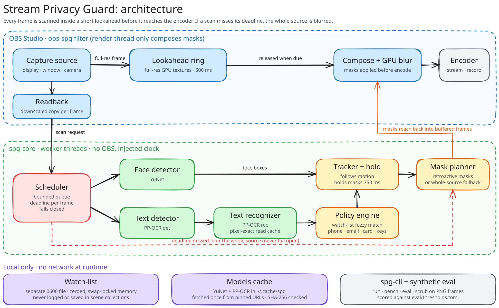

<div align="center">

# Stream Privacy Guard

**An OBS Studio filter that blurs faces, your real name and address, and personal data like card numbers before OBS encodes the frame.**

[](https://github.com/neanicc/stream-privacy-guard/actions/workflows/check.yml)
[](LICENSE)


[How it works](#how-it-works) · [Install](#install) · [Usage](#usage) · [Results](#results) · [Limitations](#limitations) · [Privacy](#privacy) · [Build from source](#build-from-source)

<!--
  TODO (after the live test, #71): replace the block below with the demo.
  Record it with made-up details only (for example "Jordan Fakeperson",
  "742 Evergreen Terrace"), never your real ones. Example:

  <a href="https://www.youtube.com/watch?v=VIDEO_ID">
    
  </a>
  <br><em>▶ Watch the full demo</em>
-->
<table><tr><td align="center" width="760">
<br>
<b>Demo video coming soon</b><br>
<sub>It'll show the filter running live in OBS, using made-up details.</sub>
<br><br>
</td></tr></table>

</div>

---

Streamers leak personal details by accident: a notification with their real name, an address in a delivery app, a card number in a browser tab. Once a frame has aired, it can't be taken back.

Stream Privacy Guard holds each frame back for half a second by default, scans it, and blurs anything sensitive before OBS encodes it. When it can't finish scanning a frame in time, it blurs the whole source instead of letting an unchecked frame through.

> [!IMPORTANT]
> **This is a safety net, not a guarantee.** It lowers the chance that something private airs, but some things will still get through. Keep personal information off screen; treat this filter as a second line of defence.

## Features

| | |
| --- | --- |
| **Faces** | Blurs faces in camera, window and display captures (YuNet). |
| **Your watch-list** | Blurs strings you add, such as your real name, address or alt accounts. Matching is fuzzy, so the filter still catches a name the OCR reads with a typo. |
| **Personal data** | Detects email addresses, phone numbers, payment card numbers, IP addresses, street addresses, and API and stream keys. |
| **Retroactive masking** | When the filter finds something, it also blurs the earlier frames still waiting in the lookahead buffer, so the blur usually covers a secret from its first frame. It can't reach frames that already aired. |
| **Fails closed** | If the scan misses a frame's deadline, the filter blurs the whole source. No setting airs an unscanned frame. |
| **Follows motion** | Masks move with scrolling chat and dragged windows, and by default stay on for 750 ms after the last detection. |
| **Fully local** | The plugin makes no network calls and has no accounts or telemetry. Watch-list entries never reach logs or scene collections. |

## How it works



<sub>Drawn in Excalidraw. To edit it, open <a href="docs/architecture.excalidraw"><code>docs/architecture.excalidraw</code></a> or the SVG, which embeds the scene, at <a href="https://excalidraw.com">excalidraw.com</a>.</sub>

1. **Capture.** The filter keeps each full-resolution frame in a lookahead ring on the GPU, 500 ms deep by default, and reads back a downscaled copy to scan.
2. **Scan.** On worker threads, the scheduler runs the face detector and the text detector side by side. The recognizer then reads the text, skipping any region whose pixels haven't changed since its last read.
3. **Decide.** The policy engine fuzzy-matches what it read against your watch-list and checks it for personal-data patterns, while the tracker keeps masks on content that moves.
4. **Mask.** The mask planner adds new masks to every buffered frame that hasn't aired yet. The render thread only draws masks and runs the GPU blur; it never waits on detection.
5. **Fail closed.** If a frame reaches its deadline unscanned, the fallback applies: blur the whole source (the default), repeat the last scanned frame, or a solid fill.

The core library, `spg-core`, doesn't depend on OBS, which is why the same pipeline runs headless in `spg-cli` and in CI. Design notes live in [docs/plan.md](docs/plan.md), [docs/scheduler.md](docs/scheduler.md), [docs/policy.md](docs/policy.md) and [docs/plugin-render.md](docs/plugin-render.md).

## Install

> [!NOTE]
> **There's no release yet.** Until there is, grab the `packages-<os>` artifacts from a green [Check run](https://github.com/neanicc/stream-privacy-guard/actions/workflows/check.yml) or [build from source](#build-from-source).
<!-- TODO (after the live test): once v0.1.0 is published, replace the note above with:
> **[Download the latest release](https://github.com/neanicc/stream-privacy-guard/releases/latest)**
-->

| OS | Package | Copy this | Into |
| --- | --- | --- | --- |
| macOS 14+ (Apple Silicon) | `obs-spg-<version>-macos-arm64.zip` | `obs-spg.plugin` | `~/Library/Application Support/obs-studio/plugins/` |
| Windows 10/11 x64 | `obs-spg-<version>-windows-x64.zip` | the `obs-spg` folder | `C:\ProgramData\obs-studio\plugins\` |
| Linux x86_64 | `obs-spg-<version>-linux-x64.tar.gz` | the `obs-spg` folder | `~/.config/obs-studio/plugins/` |

1. **Quit OBS and copy the plugin** as shown above. You need OBS Studio 32.1 or a later 32.x release.
   - On Linux, use a native OBS install, not the Flatpak, with glibc 2.39 or newer.
   - On Windows, the plugin uses the Visual C++ 2015–2022 Redistributable (x64) that OBS already requires.
2. **macOS only: clear the quarantine flag.** The packages aren't notarized, so macOS blocks a downloaded copy until you run:
   ```sh
   xattr -dr com.apple.quarantine ~/Library/Application\ Support/obs-studio/plugins/obs-spg.plugin
   ```
3. **Fetch the detection models once.** The packages don't include model weights. From the unpacked folder, run:
   ```sh
   python3 scripts/fetch_models.py      # Windows: python scripts\fetch_models.py
   ```
   The script pulls YuNet and PP-OCR from the pinned URLs in [`models/manifest.json`](models/manifest.json), checks each file's SHA-256 and puts them in `~/.cache/spg/models`. The plugin itself never downloads anything.
4. **Start OBS.** To uninstall, delete what you copied. Watch-list files stay in OBS's `plugin_config/obs-spg/` folder and the models stay in the cache until you delete them.

## Usage

1. Right-click the source to protect (a display, window or camera capture) and choose **Filters**. Click **+** under *Effect Filters* and add **Privacy Guard**.
2. **Add watch-list entries.** Type your real name, address, account names or other strings into **New entry**, which hides each character as you type, then click **Add entry**. After that the filter won't show the entry again, not even to you.
3. **Choose what to detect.** Faces, watch-list entries and every personal-data category are on by default.
4. **Sync your audio.** The filter delays video by the lookahead (500 ms by default) but can't delay audio. In **Edit › Advanced Audio Properties**, set **Sync Offset** to the lookahead on every audio source that goes with this video. If the video memory budget forces a shorter lookahead, the filter's properties show a warning with the real number, so use that or raise the budget.

<details>
<summary><b>Settings at a glance</b></summary>

| Setting | Default | What it does |
| --- | --- | --- |
| Lookahead | 500 ms (100–2000) | How long frames are held for scanning. Longer means more scanning time, but more stream delay. |
| Video memory for the lookahead | 512 MiB | Caps the frames held on the GPU. If the lookahead doesn't fit, the filter shortens it and warns you with the real value. |
| Mask hold | 750 ms | How long a region stays blurred after its last detection. |
| Watch-list sensitivity | Standard | Standard or High fuzzy-matching tolerance. |
| When a frame can't be scanned in time | Blur the whole source | You can also repeat the last scanned frame or show a solid fill. No option shows an unscanned frame. |
| Debug overlay | Off | Draws mask outlines on the source. The outlines air too, so use it only for testing. |

The properties panel also counts how many frames aired with only their detected regions masked and how many aired fully covered, along with the last reason. [docs/settings.md](docs/settings.md) has the full reference.

</details>

## Results

### Synthetic evaluation

`bash scripts/ci/run.sh eval --local` scores the pipeline on generated scenes with chat, documents, notifications, scrolling text and faces. These numbers come from commit `f5502ce` on a fanless Apple M4 MacBook Air plugged into power. Timing moves around between runs, so the realtime fail-closed row gives the median and range of 7 interleaved runs from #99; a busy machine does worse, as [Limitations](#limitations) explains. [`eval/thresholds.toml`](eval/thresholds.toml) sets the targets and [docs/eval.md](docs/eval.md) defines each metric.

| Suite | Metric | Result | Target |
| --- | --- | ---: | ---: |
| Text | Watch-list recall | **99.9%** | ≥ 97% |
| Text | Caught on the first frame shown | **96.2%** | ≥ 95% |
| Text | Personal-data recall | **99.9%** | ≥ 90% |
| Text | Frames with a leak | **0.36%** | ≤ 2% |
| Text | Blurred area on clean frames | **0.25%** | ≤ 3% |
| Text | Harmless text blurred near secrets (decoy blur) | **52.8%** | ≤ 55% |
| Faces | Face recall | **100%** | ≥ 90% |
| Faces | Frames with a leak | **0%** | ≤ 5% |
| Realtime (1080p60) | Frames covered by the fail-closed fallback | **0.22%** median (0–1.04% over 7 runs) | ≤ 1% |
| Realtime (1080p60) | Detection latency, p95 | **255 ms** | ≤ 400 ms |

Generated scenes are simpler than a real desktop, so none of this proves how the filter behaves on a live stream.

### Live test

<!--
  TODO (after the live test, #71): fill in this table from docs/live-check.md
  and link the results entry. Keep recordings and screenshots of the test
  out of Git.
-->

| Check | Result |
| --- | --- |
| Tested on | _pending: Mac model, macOS, OBS version, canvas_ |
| Plugin loads; planted strings blurred from their first frame | _pending_ |
| Scrolling chat, typing into a field, alt-tab, scene switches | _pending_ |
| `spg-cli scrub` on the recorded session (leak frames) | _pending_ |
| Render cost (Stats dock, filter on vs off) | _pending_ |
| Fail-closed under CPU load | _pending_ |

[docs/live-check.md](docs/live-check.md) has the full protocol.

## Limitations

Read these before you rely on the filter.

- **Anything missed has already aired.** No setting makes detection complete.
- **Nobody has run it in a live session yet.** CI loads the module into a headless libobs, but the GPU readback and the blur need a real graphics context. [Live test](#live-test) tracks this.
  <!-- TODO (after the live test): reword this bullet to state what was tested and on what hardware. -->
- **A busy machine covers more frames.** With a game and an encoder fighting over the CPU, more frames miss their deadline and air fully blurred; under two busy CPU loops in testing, 1.3% of frames fell back.
- **Some things slip past detection.** Faces smaller than about 30 px at 1080p, text with a cap height under about 10 px, upside-down text, and text the OCR misreads beyond the fuzzy-match tolerance can all get through.
- **It blurs too much near secrets.** Harmless text next to sensitive text often gets blurred too, especially in scrolling chat. In the synthetic suite that's about half of the decoy text. Erring toward blur is deliberate, and [#97](https://github.com/neanicc/stream-privacy-guard/issues/97) tracks bringing it down without opening a leak.
- **Video airs late, and you fix the audio.** Video runs one lookahead behind and you set the audio Sync Offset yourself. At 1080p60 the 500 ms lookahead holds about 240 MB of video memory, and at 4K the default budget shortens it.
- **Hardware and platforms.** Windows and Linux run inference on the CPU only, while macOS may use Core ML through ONNX Runtime. Builds exist for macOS 14+ on Apple Silicon (no Intel), Windows x64, and Linux x86_64 built on Ubuntu 24.04. The filter captures HDR sources as 8-bit, and nobody has tested HDR yet.
- **Packages aren't signed.** See [Install](#install).

## Privacy

- **No network at runtime.** The plugin makes no network calls and has no accounts, telemetry or crash upload. The only download is the one you run yourself, `scripts/fetch_models.py`, which pulls from pinned URLs and checks SHA-256.
- **Watch-list entries stay out of scene collections.** People share scene collections when they ask for help, so the filter settings hold only a random reference. The entries sit in a separate file that only your user can read on macOS and Linux.
- **Entries stay out of logs, and out of crash dumps where the OS allows it.** The plugin never logs entries or recognized text. It keeps them in memory that it wipes on release and locks against swapping where it can, and it excludes that memory from Linux crash dumps and Windows Error Reporting dumps. macOS has no equivalent exclusion, and on any OS a debugger can still read the memory. [docs/settings.md](docs/settings.md#watch-list-text-in-memory) covers the gaps.
- **Frames never touch the disk.** The plugin has no frame-capture option; it keeps frames in memory for the lookahead and nowhere else.

## Build from source

Requirements:
- CMake 3.25+.
- A C++20 compiler: Xcode clang, GCC or Clang, or Visual Studio 2022+.
- Python 3.12+ and `curl`.

Supported hosts are Linux x64, macOS on Apple Silicon and Windows x64 (use Git Bash).

```sh
bash scripts/ci/run.sh setup   # fetch pinned ONNX Runtime, OpenCV, libobs and models (SHA-256 verified)
bash scripts/ci/run.sh build   # build into build/ (Release, warnings as errors)
bash scripts/ci/run.sh test    # run every test with ctest
bash scripts/ci/run.sh eval    # generate the CI text suite, run the pipeline on it and score it
```

The plugin builds to `build/plugin/`. The command-line tool `build/cli/spg-cli` on Linux and macOS (`build/cli/Release/spg-cli.exe` on Windows) runs the same pipeline on PNG frames: `run`, `bench`, `eval`, and `scrub` for checking a recording for leaks. See [docs/cli.md](docs/cli.md).

<details>
<summary><b>Dependencies, caching and packaging</b></summary>

- **Dependencies.** `setup` downloads the archives listed in [`deps/manifest.json`](deps/manifest.json) once into `$SPG_CACHE_DIR` (default `~/.cache/spg`), and refuses any file whose hash doesn't match. CMake fetches Catch2, nlohmann/json and stb_image, also pinned by hash.
- **Libobs.** On Linux, it comes from the official OBS 32.1.2 package. On macOS and Windows, it is built once from the pinned OBS sources and cached.
- **Configuration flags.** Set `SPG_BUILD_PLUGIN=0` to skip the plugin, or configure with `-DSPG_WITH_DEPS=OFF` to build without ONNX Runtime and OpenCV.
- **Models.** Weights never enter Git, and nothing downloads them at runtime.

```sh
bash scripts/ci/run.sh package                      # dist/obs-spg-<version>-<os>.(zip|tar.gz)
bash scripts/package.sh build dist --with-models    # local only: also bundle the cached models
```

`scripts/package.sh` stages the plugin with `INSTALL.txt`, the license, third-party notices and the model fetch script. Before it writes the archive and `SHA256SUMS.txt`, it checks that every library the plugin imports either ships beside it or comes from OBS or the OS, that macOS rpaths stay inside the bundle and the signature verifies, and that no model file slipped in unless you passed `--with-models`.

[docs/ci.md](docs/ci.md) lists the CI checks, and the draft release notes are in [docs/release-notes/0.1.0.md](docs/release-notes/0.1.0.md).

</details>

## Roadmap

- [x] Faces, watch-list and personal-data detection in a fail-closed realtime pipeline
- [x] Retroactive masking, motion tracking and temporal hold
- [x] Synthetic evaluation passing every limit in [`eval/thresholds.toml`](eval/thresholds.toml)
- [ ] Live OBS test and human leak test ([#71](https://github.com/neanicc/stream-privacy-guard/issues/71))
- [ ] First release, v0.1.0
- [ ] More headroom on busy machines ([#86](https://github.com/neanicc/stream-privacy-guard/issues/86))
- [ ] Less over-blurring near secrets ([#97](https://github.com/neanicc/stream-privacy-guard/issues/97))
- [ ] Windows GPU inference ([#25](https://github.com/neanicc/stream-privacy-guard/issues/25))

## How this repository is built

Coding agents write most of the code here, working through GitHub issues and pull requests. Every PR runs CI on Linux, macOS and Windows and gets a staff review against [AGENTS.md](AGENTS.md) plus a Greptile review, and nothing merges until a gate confirms green CI, an approving staff review with no P0 or P1 findings and a score of 85 or more, and no open review threads ([docs/autopilot.md](docs/autopilot.md) has the full list). I own the thresholds, the CI workflows and the live testing; agents can propose changes to those but can't merge them.

[docs/agent-log.md](docs/agent-log.md) records every decision along the way.

## License

GPL-2.0, because OBS plugins link against libobs. See [LICENSE](LICENSE).

Packages include the licenses of ONNX Runtime (MIT), OpenCV (Apache-2.0) and nlohmann/json (MIT). The detection models, YuNet (MIT) and PP-OCR via RapidOCR (Apache-2.0), aren't in the default packages, though `--with-models` adds them with their license texts. [`models/manifest.json`](models/manifest.json) records where each comes from and its license.
